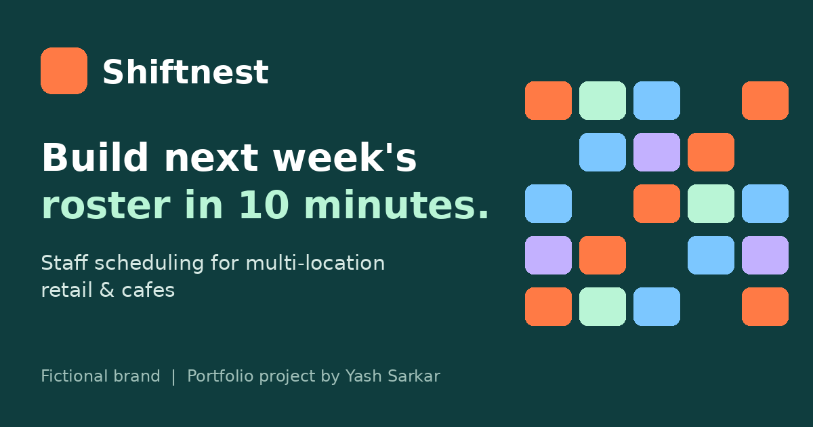

# Shiftnest — B2B SaaS landing page (fictional brand)

**Live site:** https://yashsarkar1806-creator.github.io/shiftnest-saas-landing/  
**Marketing brief:** https://yashsarkar1806-creator.github.io/shiftnest-saas-landing/brief.html  
**Preview an A/B variant + tracking inspector:** [`?variant=B&debug=1`](https://yashsarkar1806-creator.github.io/shiftnest-saas-landing/?variant=B&debug=1)



Shiftnest is a **fictional** staff-scheduling app for multi-location retail and café businesses. This repo is the
conversion-focused landing page I'd ship to launch it, plus the positioning and messaging brief behind it. Every
interactive piece works in the browser with no backend and no build step.

> **Synthetic / fictional:** Shiftnest, its prices, customer names, testimonials and savings assumptions are invented for
> this portfolio project. They are not real results and are not connected to any employer. No form data leaves your browser.

## Marketing skills shown

| Skill | Where to see it |
|---|---|
| B2B positioning, ICP and buying-group messaging | [`brief.html`](brief.html) sections 1–4, role tabs on the landing page |
| Conversion-focused page structure | Hero → problem → how it works → pricing → ROI → proof → form → FAQ (rationale in brief §5) |
| Pricing and packaging | Plan picker recommends the smallest fitting plan; regional USD/AUD/INR price points; annual discount anchoring; add-ons |
| Value selling | ROI estimator with editable, conservative assumptions and payback period, priced off the visitor's own quote |
| Experimentation | Deterministic A/B/C headline test by message angle (time / money / people), `?variant=` preview, experiment backlog with guardrails |
| Analytics and tracking | GA4-style `dataLayer` events with experiment and first-touch UTM/click-ID context; on-page event inspector (`?debug=1`) |
| Lead capture and routing | Validated demo form (work-email nudge, inline errors), lead score → sales-assist / guided trial / self-serve |
| SEO and social | Title/description, canonical, Open Graph + Twitter card with a 1200×630 image, `SoftwareApplication` JSON-LD |
| Accessibility | Skip link, labelled controls, ARIA tabs with arrow keys, `aria-live` results, focus styles, reduced-motion support |
| Channel planning | 90-day launch channel mix, tracking plan and funnel targets in the brief |

## Features

- **Hero A/B/C test:** each visitor is hashed (FNV-1a of experiment + visitor ID) into one of three headline angles and stays there on return visits.
- **Plan picker and quote:** locations, staff per site, currency, monthly/annual billing, add-ons and SSO → recommended plan and an itemised quote.
- **ROI estimator:** manager time saved, overtime avoided and no-shows avoided vs the quoted Shiftnest cost → net monthly/annual saving, return on spend and payback days.
- **Interactive product mock:** an overtime warning you can "auto-fix" in the hero roster.
- **Demo request form:** client-side validation, free-email warning, lead scoring and routing message (nothing is sent).
- **dataLayer inspector:** footer button or `?debug=1` shows every event as it fires, with buttons to switch variants or simulate a new visitor.
- **Positioning & messaging brief:** positioning statement, ICP, buying group, messaging house, page rationale, channel plan, tracking plan, experiment backlog and funnel targets.

### Tracked events

`page_view`, `experiment_impression`, `section_view`, `cta_click`, `tab_select`, `plan_quote`, `roi_calculated`,
`form_start`, `form_error`, `generate_lead`, `faq_open`, `demo_interaction`. Each carries `experiment_id`,
`experiment_variant` and any stored `utm_*` / `gclid` / `fbclid` values.

## How to run

No build step. Open `index.html`, or serve the folder:

```bash
python3 -m http.server 8000   # then visit http://localhost:8000/?debug=1
```

## Tests

All pricing, ROI, experiment-assignment, validation, lead-scoring, UTM and formatting logic lives in
[`js/logic.js`](js/logic.js) as pure functions shared by the page and the tests. Static checks also guard SEO tags,
the OG image size, form labels, unique IDs and event wiring.

```bash
node --test   # Node 18+; 37 tests
```

## Project structure

```
index.html        landing page
brief.html        positioning & messaging brief
styles.css        styles (no framework)
js/logic.js       pure logic (browser + Node)
js/app.js         UI wiring, dataLayer, inspector
test/             node:test suites
assets/           favicon, OG image
scripts/make_og.py  regenerates the OG image (Pillow)
```

## License

MIT © 2026 Yash Sarkar. Shiftnest is a fictional brand; any resemblance to real companies is coincidental.
